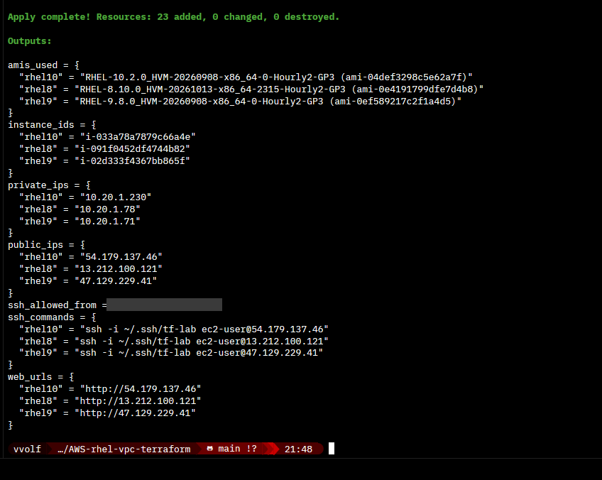
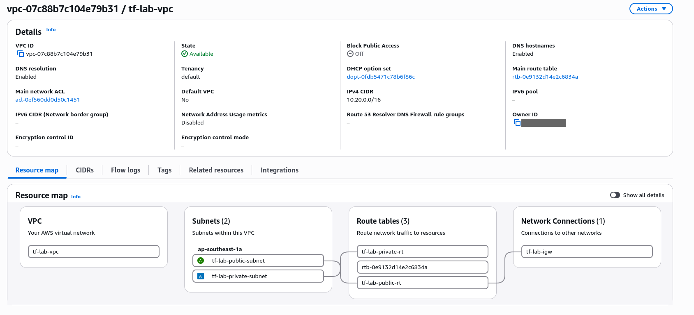
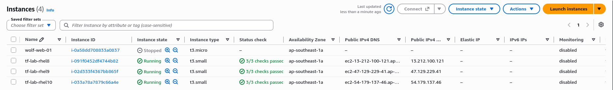
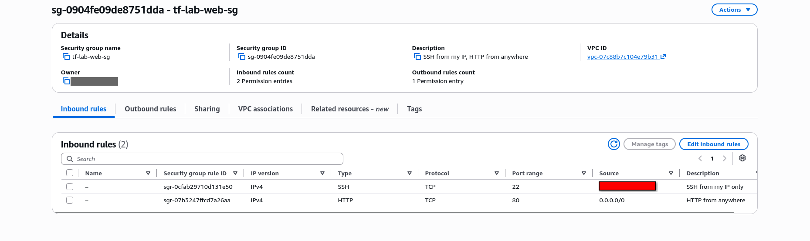
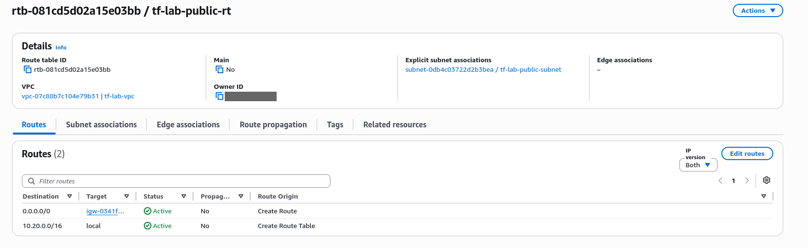
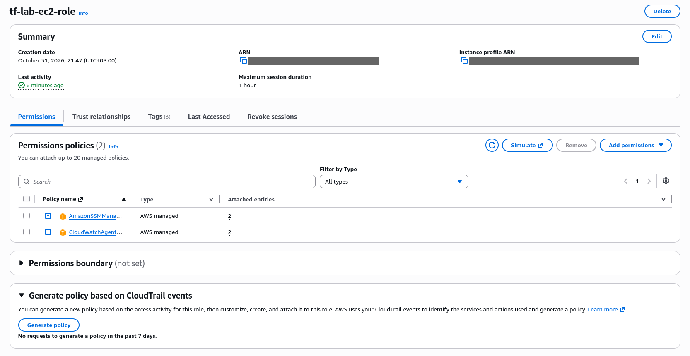
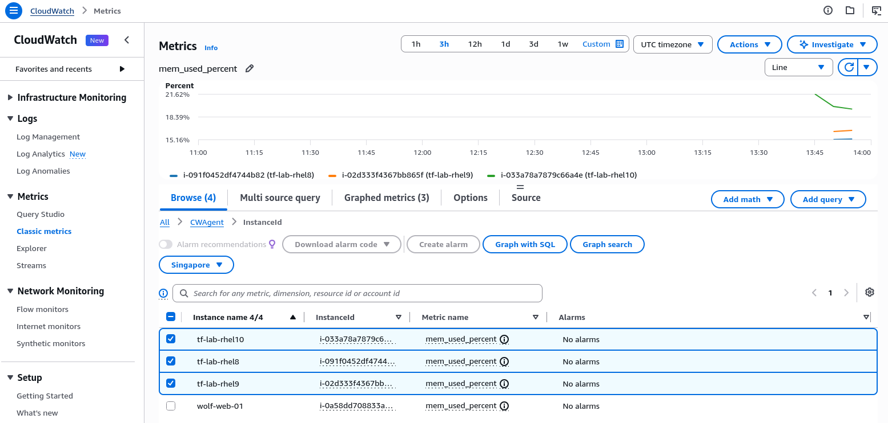
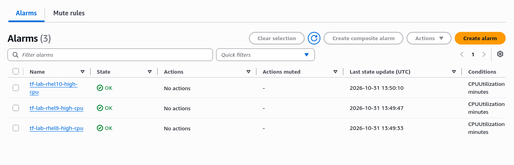
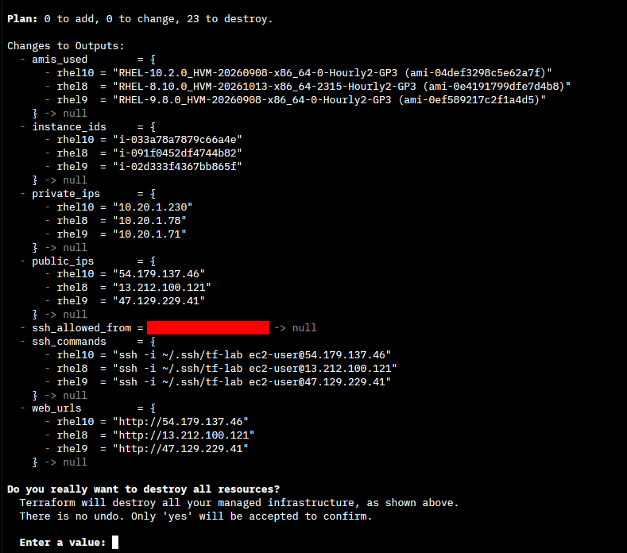
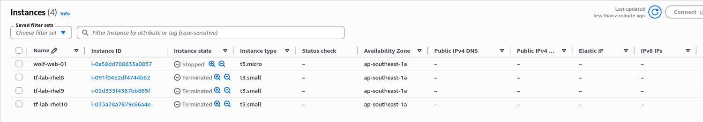

# AWS VPC + RHEL 8/9/10 Web Servers with Terraform

A small AWS lab, first built **by hand in the console** and then rebuilt as **Terraform code**. It provisions an isolated VPC with public and private subnets, an internet gateway, routing, a security group, an IAM role, three hardened RHEL web servers (**RHEL 8, 9 and 10**) and a CloudWatch CPU alarm for each.

> Built manually first, then automated. Understanding each piece by hand made the code much easier to reason about.

## Architecture

```
                    Internet
                        |
               [ Internet Gateway ]
                        |
   VPC 10.20.0.0/16 ----+-----------------------------------------
   |                                                             |
   |  Public subnet 10.20.1.0/24          Private subnet 10.20.2.0/24
   |  route: 0.0.0.0/0 -> IGW             route: local only
   |                                                             |
   |  [ tf-lab-rhel8 ]  [ tf-lab-rhel9 ]  [ tf-lab-rhel10 ]      |
   |    httpd, SSM agent, CloudWatch agent                       |
   |    SG: 22 from your IP, 80 from anywhere                    |
   |    IAM role: SSM + CloudWatch agent                         |
   ----------------------------------------------------------------
          CloudWatch alarm per instance: CPU > 50% (5 min)
```

## From console clicks to code

| Console step (done by hand) | Terraform resource | File |
|---|---|---|
| VPC → Create VPC | `aws_vpc` | `network.tf` |
| VPC → Subnets → Create subnet (public + private) | `aws_subnet` | `network.tf` |
| VPC → Internet gateways → Create + Attach | `aws_internet_gateway` | `network.tf` |
| VPC → Route tables → Create, add `0.0.0.0/0 → IGW`, associate subnet | `aws_route_table`, `aws_route_table_association` | `network.tf` |
| EC2 → Security groups → Create, add inbound rules | `aws_security_group`, `aws_vpc_security_group_*_rule` | `security.tf` |
| EC2 → Key pairs → Import key pair | `aws_key_pair` | `security.tf` |
| IAM → Roles → Create role for EC2, attach policies | `aws_iam_role`, `aws_iam_role_policy_attachment`, `aws_iam_instance_profile` | `iam.tf` |
| EC2 → Launch instance (AMI, type, subnet, SG, role, user data) | `aws_instance` (one per RHEL release) | `compute.tf` |
| CloudWatch → Alarms → Create alarm | `aws_cloudwatch_metric_alarm` | `monitoring.tf` |
| SSH in, install httpd / SSM agent / CloudWatch agent | First-boot script | `templates/user_data.sh.tftpl` |

### Hardening choices
- SSH restricted to a single `/32` (your current public IP), auto-detected at plan time
- **IMDSv2 required** (`http_tokens = "required"`)
- **Encrypted** root volumes
- IAM **role** instead of stored access keys
- Private subnet has no route to the internet

### Picking the RHEL releases

The instances come from `rhel_versions` in `variables.tf`:

```hcl
rhel_versions = {
  rhel8  = "8.10"
  rhel9  = "9.8"
  rhel10 = "10.2"
}
```

Red Hat publishes several minor releases side by side (for example 9.6 and 9.8), so the newest image by date is not always the newest release. Pinning the release keeps it predictable. Remove a line to deploy fewer instances.

## Prerequisites

- Terraform >= 1.6
- AWS CLI with a profile that can create VPC, EC2, IAM and CloudWatch resources. This lab uses an IAM user (not root) saved as the `tf-lab` profile:
  ```bash
  aws configure --profile tf-lab
  aws sts get-caller-identity --profile tf-lab
  ```
- An SSH key pair for the lab:
  ```bash
  ssh-keygen -t ed25519 -f ~/.ssh/tf-lab -C "tf-lab"
  ```

## Usage

```bash
export AWS_PROFILE=tf-lab
cp terraform.tfvars.example terraform.tfvars   # optional, defaults work
terraform init
terraform fmt -check
terraform validate
terraform plan -out tfplan
terraform apply tfplan
```

The plan creates 23 resources, and the apply takes about 30 seconds:



Give the instances **3 to 5 minutes** after apply. The first boot installs packages and agents.

```bash
terraform output web_urls       # open in a browser, each page shows its RHEL release
terraform output ssh_commands   # SSH in
```

## Verify

On each instance:
```bash
cat /etc/redhat-release
ip addr                                   # only the private 10.20.1.x IP is on the interface
ip route                                  # default via 10.20.1.1 (the VPC router)
getenforce                                # Enforcing
sudo systemctl status httpd amazon-ssm-agent
sudo /opt/aws/amazon-cloudwatch-agent/bin/amazon-cloudwatch-agent-ctl -a status
sudo tail -50 /var/log/cloud-init-output.log  # user data output
```

In the AWS console:
- **VPC → Your VPCs / Subnets / Route tables**: `tf-lab-*` resources
- **EC2 → Instance → Connect → Session Manager**: shell access without SSH (via the IAM role)
- **CloudWatch → Metrics → CWAgent**: `mem_used_percent`, `disk_used_percent`

**VPC resource map**: the public subnet goes through `tf-lab-public-rt` to the internet gateway, the private subnet only has `tf-lab-private-rt` (local routes).



**EC2 instances**: the three servers next to `wolf-web-01`, the instance built by hand in the console first.



**Security group**: SSH only from your IP, HTTP from anywhere.



**Public route table**: the `0.0.0.0/0 → igw` route is what makes the subnet public.



**IAM role**: the two AWS managed policies for SSM and the CloudWatch agent, attached to all three servers through the instance profile.



**CloudWatch agent metrics**: memory usage from inside each OS, something basic EC2 metrics can't see. Found under CloudWatch → Metrics → Classic metrics → CWAgent → InstanceId.



## Trigger the CPU alarm

One alarm per server, all **OK** while idle. No actions are attached, so they only change state (no email):



On one instance:
```bash
yes > /dev/null &
yes > /dev/null &
# wait 5-10 minutes, then check CloudWatch -> Alarms -> tf-lab-rhel9-high-cpu
killall yes
```

## Break it and fix it

| Break | Symptom from the client | Meaning |
|---|---|---|
| Remove the HTTP rule from the security group | `curl` hangs, then times out | Traffic silently dropped (firewall / routing) |
| Remove `0.0.0.0/0 → IGW` from the public route table | Web **and** SSH time out | No path back to the internet |
| `sudo systemctl stop httpd` | `connection refused` immediately | Network fine, nothing listening |

Running `terraform plan` after a manual change shows the **drift**, and `terraform apply` puts it back.

## Clean up

```bash
terraform destroy
```

The plan lists the same 23 resources and asks for `yes`:



About 30 seconds later:

```
Destroy complete! Resources: 23 destroyed.
```

The three servers show as **Terminated**. `wolf-web-01` (built by hand) is untouched, Terraform only deletes what it created:



RHEL instances are **not free tier**: the RHEL licence is billed hourly on top of EC2. Destroy when you're done and check **Billing** the next day to confirm nothing is left running.

## Lessons learned

- **RHEL AMIs don't ship the SSM agent** (Amazon Linux does), so Session Manager and console-based CloudWatch agent installs fail until it's installed.
- **The OS never sees its public IP.** The internet gateway does one-to-one NAT at the edge.
- **Basic EC2 metrics can't see memory or disk usage.** That needs the CloudWatch agent inside the OS.
- **Timeout vs connection refused** tells you whether to look at the network or the service.
- **The newest RHEL image isn't always the newest release.** Red Hat refreshes older minor releases too, so "most recent" can pick 9.6 over 9.8.
